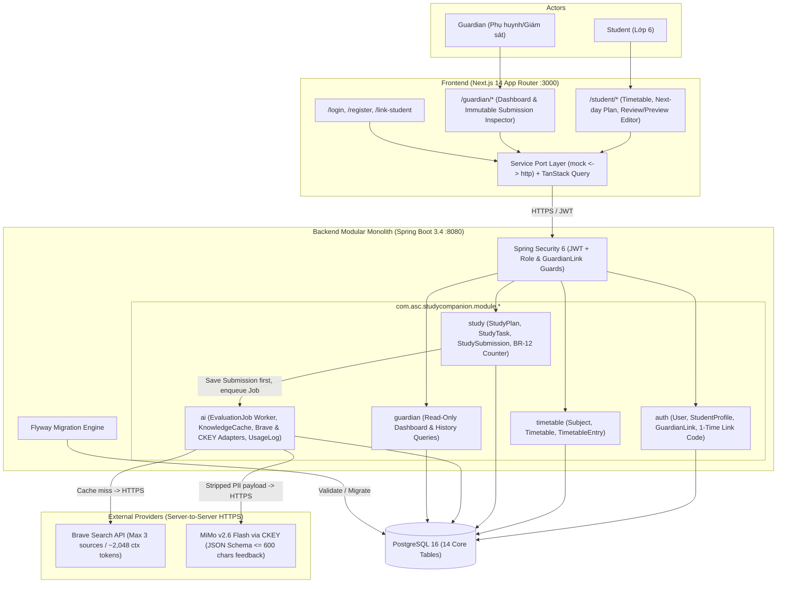

# SYSTEM ARCHITECTURE DOCUMENT (ARCHITECTURE.md)
**Product Name:** AI Study Companion – Grade 6 (`SRS-ASC-G6-001`)  
**Architecture Style:** Modular Monolith (Backend) + App Router Web Client (Frontend) in a Monorepo  
**Java Package Root:** `com.asc.studycompanion`  
**Document Version:** 1.0 (Baseline — Clean Migration from Legacy Domain)  

---

## 1. Technology Stack

### 1.1 Backend (`backend/`)
- **Language & Framework:** Java 21, Spring Boot 3.4.x
- **Security:** Spring Security 6, Stateless JWT Access Token (`jjwt`), BCrypt Password Hashing, Strict Student/Guardian Anti-IDOR Guards
- **Database & Migration:** PostgreSQL 16, Spring Data JPA (Hibernate 6.x with `ddl-auto=validate`), Flyway Migrations
- **AI & Search Orchestration:**
  - `SearchProvider` adapter interface $\rightarrow$ **Brave Search API** client (`RestClient` / HTTPS)
  - `AiEvaluationProvider` adapter interface $\rightarrow$ **MiMo v2.6 Flash via CKEY** client (OpenAI-compatible Chat Completions / JSON mode)
  - DB-backed asynchronous `EvaluationJob` queue + Spring Scheduling/Executor with rate limiting, exponential backoff + jitter retry, `KnowledgeCache`, and `AIUsageLog`
- **Utilities:** Lombok, MapStruct, Jakarta Validation

### 1.2 Frontend (`frontend/`)
- **Framework:** Next.js 14+ (App Router), React 18, TypeScript (Strict Mode, zero `any`)
- **Styling & UI:** TailwindCSS, Shadcn/UI (Radix Primitives), Lucide React (`strokeWidth={1.75}`), `#E85D04` Burnt Orange + Light/Dark Top Bar switcher (`next-themes`)
- **Typography:** `Be Vietnam Pro` (`vietnamese`, `latin`) & `JetBrains Mono` (`tabular-nums` cho bộ đếm ký tự, mã môn và mốc thời gian)
- **State & Data Fetching:** TanStack Query v5 (kèm polling trạng thái `EVALUATING`), Zustand (Client Auth Store), React Hook Form + Zod, Service Port Layer (`src/services/{mock,http}`) phục vụ UI-First Prototype trước khi nối API thật

### 1.3 Infrastructure & Environment
- **Local & Container Runtime:** Docker Compose (`postgres:16`, `backend`, `frontend`)
- **Timezone & Locale:** `Asia/Ho_Chi_Minh` (`APP_TIMEZONE`), `vi-VN`
- **Secret Isolation:** `CKEY_API_KEY`, `BRAVE_API_KEY`, `JWT_SECRET`, DB credentials chỉ đọc từ biến môi trường tại Backend — không bao giờ truyền xuống Frontend.

---

## 2. System Container Diagram



---

## 3. Monorepo Folder Structure (Target Architecture)

```text
├── docs/                               # Single Source of Truth
│   ├── PRD.md
│   ├── ARCHITECTURE.md
│   ├── DESIGN.md
│   ├── RULES.md
│   ├── TASKS.md
│   └── PROGRESS.md
├── backend/
│   └── src/main/java/com/asc/studycompanion/
│       ├── StudyCompanionApplication.java
│       ├── common/                     # ApiResponse<T>, AppException, ErrorCode, GlobalExceptionHandler, BaseEntity
│       ├── config/                     # SecurityConfig, JpaAuditingConfig, AiProperties, TimeConfig
│       ├── security/                   # JwtTokenProvider, JwtAuthFilter, UserPrincipal, CustomUserDetailsService
│       └── module/
│           ├── auth/                   # User, StudentProfile, GuardianLink, LinkCode, AuthController
│           ├── timetable/              # Subject, Timetable, TimetableEntry
│           ├── study/                  # StudyPlan, StudyTask, StudySubmission (v1..v4 immutable)
│           ├── ai/                     # EvaluationJob, AIEvaluation, SourceReference, KnowledgeCache, AIUsageLog, Brave/CKEY adapters
│           └── guardian/               # GuardianDashboardController & Query Service
└── frontend/
    └── src/
        ├── app/
        │   ├── (auth)/                 # /login, /register
        │   ├── link-student/           # Student-Guardian 8-char 1-time link code flow
        │   ├── student/                # /student/today, /student/timetable, /student/tasks/[taskId]
        │   └── guardian/               # /guardian/dashboard, /guardian/submissions/[submissionId]
        ├── components/                 # ui/, shared/, student/, guardian/, auth/
        ├── lib/                        # api-client.ts, auth-token.ts, study-utils.ts (BR-12 char count)
        ├── mocks/                      # mock-runtime.ts, fixtures/ (Phase 2 UI-First)
        ├── services/                   # Service interfaces + mock/ & http/ implementations
        ├── store/                      # auth-store.ts
        └── types/                      # Strict DTO interfaces matching DESIGN.md 1-to-1
```

---

## 4. Key Architectural Flows

### 4.1 Immutable Submission & Async AI Evaluation Pipeline (`BR-13`, `BR-14`, `FR-OPS-01..05`)
1. Client validates `title` non-blank and `countNormalizedChars(content)` in `[400, 3000]` before enabling `Submit` (**zero AI calls while typing**; `localStorage` draft optional).
2. Student sends `POST /api/study/tasks/{taskId}/submissions` with `Idempotency-Key` header.
3. `StudyService` validates task ownership, `REVIEW` completion lock (if `PREVIEW`), revision quota (`max 3 updates after AI feedback` $\rightarrow$ max `4` versions, and blocks while `EVALUATING`), normalizes/counts characters identically to frontend, and **persists `StudySubmission` + `EvaluationJob` (`PENDING`) atomically in PostgreSQL before any external HTTP call**.
4. Async Worker picks up `EvaluationJob`:
   - Checks `KnowledgeCache` (by normalized `grade + subject + lessonTitle + policyVersion`).
   - On cache miss, calls **Brave Search API** (query: `Lớp 6 + subjectName + lessonTitle`, up to 3 relevant/clean sources, ~2,048 tokens budget).
   - Builds PII-free prompt (`grade=6`, `subject`, `taskType`, `lessonTitle`, `studentText`, `sourcesContext`) and calls **MiMo v2.6 Flash via CKEY** once.
   - Validates JSON enum contract (`accuracy`, `completeness`, `overall_status`, `confidence`, valid `sources`, Vietnamese student display feedback `<= 600` chars). Retries transient `timeout`/`429`/`5xx` with exponential backoff + jitter; caps formatting retry at 1; transitions cleanly to `EVALUATION_FAILED` when retries exhaust without ever losing `StudySubmission`.
